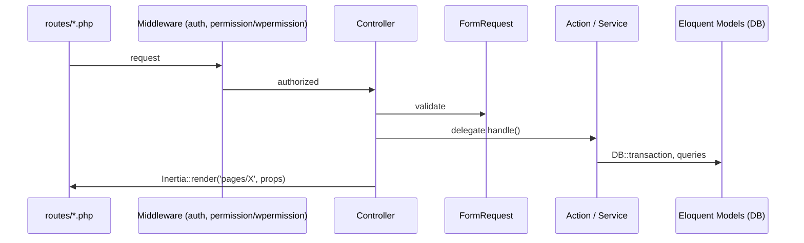

# Repository Guidelines

Indonesian government e-surat (electronic letter) management system. Two rules above all: **query the knowledge graph before exploring code** (see `## graphify`), and **verify before declaring done** (see `## Definition of Done`).

## graphify

This project has a knowledge graph at `graphify-out/` (god nodes, communities, cross-file edges). It is **scoped to `app/`, `bootstrap/`, `config/`, `database/`, `resources/`, `routes/`, `tests/`, and `AGENTS.md`** — declared in `/.graphifyignore` (allowlist, git-ignored). It deliberately EXCLUDES `public/`, `.github/`, root manifests (`composer.json`, `package.json`, …), and this README. Do not widen or change the scope without editing `/.graphifyignore`; `graphify update .`, `graphify extract`, and the post-commit hook all honor it.

**Query first, read second.** When `graphify-out/graph.json` exists, run `graphify query "<question>"` BEFORE your first grep/search/source-read for any codebase question. Use `graphify path "<A>" "<B>"` for relationships and `graphify explain "<concept>"` for one concept. These return a scoped subgraph, far smaller than grepping. Read raw files only for lines the graph already located. Put this rule in every subagent prompt that explores code.

**At session start**, run `graphify reflect --if-stale` (cheap, no LLM) and read `graphify-out/reflections/LESSONS.md` for preferred sources and known dead ends.

**Never update the graph unprompted.** After modifying code, do NOT run `graphify update .` on your own. Run it only when (a) the user explicitly asks for it, or (b) the user asks to commit — in which case ASK first, before staging or committing:

> "Update the knowledge graph before committing? (`graphify update .` — AST-only, no API cost)"

Run the update only if they say yes; if they say no, commit without it. `graphify-out/` is git-ignored, so the update never becomes part of the commit itself. If the post-commit hook is installed (`graphify hook install`), a background AST rebuild may run after the commit — dirty `graphify-out/` files are then expected, not an error.

Rules:

- `graphify-out/` is GENERATED and git-ignored. Never hand-edit it. `graph.json` is rewritten whole each build, so large diffs between runs are normal.
- Dirty graph files are not a reason to skip graphify. Only skip it when the task IS about stale/incorrect graph output, or the user explicitly says so.
- Read `graphify-out/GRAPH_REPORT.md` only for broad architecture review, or when query/path/explain don't surface enough context.
- Portable launcher form (`graphify …`) works cross-platform; the resolved interpreter path lives in `graphify-out/.graphify_python` and is an implementation detail — don't hardcode it in docs.
- Never hand-write a `## graphify` heading elsewhere in this file: it is the install marker `graphify codex install` / friends replace in place.

## Project Overview

Built on **Laravel ^13 + Inertia v3 + Vue 3 (TypeScript)**. Manages the lifecycle of official letters: compose/send (`surat`), internal memos (`nota dinas`), dispositions (`disposisi`), inbox (primary + invitations/`undangan`), archive (`arsip`), plus master data (users/pengguna, positions/jabatan, roles & permissions, archive classification codes, follow-ups). Auth is **Laravel Fortify** (email/password, 2FA, passkeys) layered with **spatie/laravel-permission** for RBAC.

Derived from the Laravel Vue starter kit — README says "Laravel 12" but `composer.json` requires `laravel/framework ^13.0`; trust composer.json.

## Architecture & Data Flow

MVC + a thin **Action layer** for business logic. Request lifecycle:



Key facts:

- **Route modules**: each domain owns a routes file loaded from `routes/web.php` (`memo.php`, `disposition.php`, `inbox.php`, `arsip.php`, `master.php`, `settings.php`). Routes use `Route::prefix()` + per-route permission middleware, e.g. `Route::get('sent/{letter_id}', ...)->middleware('permission:sent.show')->name('sent.show')`.
- **Authorization**: exclusively middleware — aliases `permission`, `role`, `role_or_permission` (spatie) and `wpermission` (custom `WildcardPermissionMiddleware`) registered in `bootstrap/app.php`. No policies. Permissions are seeded per feature (`sent.index`, `memo.close`, `compose.create`).
- **Inertia**: `HandleInertiaRequests` shares `auth.user`, ziggy routes, an Inspiring quote, and sidebar badge counts (primary/undangan/disposisi/memo) computed from `user->currentPosition()`. `HandleAppearance` syncs the `appearance` cookie (excluded from encryption along with `sidebar_state`).
- **Data flow to frontend**: controllers return typed props (including `breadcrumbItems`); lists use `paginate(15)->withQueryString()` with `whereLike` search. Vue types live in `resources/js/types/models/*` and must be updated in lockstep with backend props.
- Core domain writes (letter + agenda number + recipients + docs) happen inside `DB::transaction` in Actions — e.g. `CreateComposeLetterAction` generates the agenda number from `RefAgendaSurat`/`RefKdKlasifikasi` and a custom ULID.

## Key Directories

| Path | Purpose |
|---|---|
| `app/Http/Controllers/` | Thin orchestrators; subdirs `MasterData/`, `Inbox/`, `Settings/` |
| `app/Http/Requests/` | One FormRequest per write op (`StoreComposeRequest`, `UpdateSentRecipientsRequest`, `MasterData/*`) |
| `app/Actions/<Domain>/` | Business logic; domains: `Letter`, `Memo`, `Disposition`, `Dashboard`, `MasterData/{User,Role,Position,KodeKlasifikasi,Followup}`, `Fortify` |
| `app/Models/` | Eloquent models (Indonesian table names, e.g. `letters`, `ref_agenda_surat`, `model_has_special_dispositions`) |
| `app/Services/` | Cross-cutting services (`LetterActivityService`) |
| `bootstrap/` | `app.php` middleware aliases + web stack; `providers.php` |
| `routes/` | Module route files (see above) |
| `resources/js/pages/` | Inertia pages; mirrors routes: `app/{sent,memo,disposition,primary,undangan}`, `archive/`, `master/`, `settings/`, `auth/` |
| `resources/js/components/` | Shared components; `ui/` is generated shadcn-style (reka-ui) — **do not edit** |
| `resources/js/composables/` | `usePermissions`, `useAppearance`, `useFormattedDate`, `useDecades`, `useClearErrorsOnChange`, … |
| `resources/js/types/` | Shared types: `models/*`, `index.d.ts`, `ziggy.d.ts` |
| `tests/` | Pest suites: `Unit/`, `Feature/{Auth,Settings,…}` |

## Development Commands

```bash
composer setup            # full bootstrap: install, .env, key, migrate, npm install, build
composer dev              # concurrently: php artisan serve + queue:listen + npm run dev
npm run dev               # vite-plus dev server (vp dev)
npm run build             # vp build            | build:ssr: vp build + vp build --ssr
npm run check             # vp check (TS/Vue lint); check:fix to autofix
npm run types:check       # vue-tsc --noEmit
composer lint             # pint --parallel    ;  lint:check is --test (no fixes)
composer types:check      # phpstan analyse (larastan)
composer test             # config:clear + lint:check + types:check + php artisan test
composer ci:check         # npm run check + npm run types:check + @test (what CI runs)
graphify update .         # refresh knowledge graph — on request, or after ASKING at commit time (AST-only, free)
```

## Code Conventions & Common Patterns

**Backend (PHP)**

- **Actions** are the testable unit of business logic: `VerbNounAction` (`CreateMemoAction`, `UpdateUserPositionAction`, `GetDashboardStatsAction`), public `handle()` method, `DB::transaction` for multi-step writes. Controllers stay thin.
- **FormRequests** for every write endpoint; `authorize()` returns `true` (permission enforced by route middleware); `rules()` returns array-style rules. Request fields are Indonesian snake_case (`pengirim`, `perihal`, `tglSuratStr`, `penerima.*.id`).
- **Models** use Laravel attribute-based config: `#[Fillable([...])]`, `casts()` method, `#[Table('…')]` where the table name isn't the class default, `SoftDeletes` for archival entities, `@property` docblocks. Relationships are semantically named (`senderUser`, `fromPosition`).
- **Naming**: tables Indonesian plural snake_case; route names dot-scoped by module (`sent.editletter`, `memo.create.close`, `api.timeline.recipient`); permission names mirror the action (`sent.edit`, `memo.show`).
- **Errors**: validation errors flow to Inertia via FormRequests (rendered by `InputError.vue`); use `Log` for significant events; server flashes are toasted on the frontend.

**Frontend (Vue/TS)**

- `<script setup lang="ts">` + Composition API everywhere; components PascalCase, composables `useX`.
- Forms via Inertia `useForm`; navigation via `<Link>` / `router.visit()`; URLs via Ziggy `route('name')`.
- Page props typed from `resources/js/types/models/*` — update these when backend props change or `types:check` will fail.
- Reuse generated `ui/*` components (renderless reka-ui primitives) and shared components (`AppShell`, `AppSidebar`, `AppHeader`, `Heading`, `InputError`, `SmartPagination`, `DialogTimeline`); class merging via `cn`/`cva` (Tailwind classes are auto-sorted).
- Tailwind v4 (`@tailwindcss/vite`), light/dark theme via `useAppearance`, toasts via `vue-sonner` (flash init in `app.ts`).

## Important Files

| File | Why it matters |
|---|---|
| `bootstrap/app.php` | Middleware aliases (`permission`, `wpermission`, …), web stack |
| `routes/web.php` + module files | Full route/permission map; start here to find an endpoint |
| `app/Http/Middleware/HandleInertiaRequests.php` | Global Inertia props (sidebar badge counts, ziggy) |
| `app/Models/Letter.php` | Central entity (letters, recipients, docs, activities, dispositions, memos) |
| `app/Actions/Letter/CreateComposeLetterAction.php` | Reference for the compose flow (ULID, agenda number, docs, recipients, transaction) |
| `resources/js/app.ts` | Inertia bootstrap, page resolution, ziggy/theme/toast init |
| `vite.config.ts` | `lazyPlugins`, lint (`denyWarnings`, `no-console`) and fmt (150 cols, 4-space, single quotes, tailwind sort) config |
| `composer.json` / `package.json` | All scripts (above) and dependency versions |
| `.graphifyignore` | Knowledge-graph scope (allowlist); read before any graph rebuild |

## Runtime/Tooling Preferences

- **PHP ^8.3** (CI: 8.4), **Laravel ^13**, **Node 22** (CI), **npm only** (npm lockfile; no pnpm/yarn).
- **Build = vite-plus** (`vp`): `package.json` overrides `vite` → `@voidzero-dev/vite-plus-core` — non-standard; don't change. Inertia SSR is disabled (`inertia({ ssr: false })`).
- **Formatting**: Pint (PHP); `vp` fmt/lint for TS/Vue. `.editorconfig`: 4-space indent, LF; YAML 2-space. `no-console` error (only `warn`/`error` allowed).
- `laravel/boost` installed (`boost.json` is empty); `phpstan.neon` runs larastan via `composer types:check`.

## Testing & QA

- **Pest ^4**; `tests/Pest.php` binds `TestCase` for `Feature` only. In-memory SQLite (`phpunit.xml`: `DB_CONNECTION=sqlite`, `:memory:`), `RefreshDatabase` per feature test file.
- Layout mirrors conventions: `tests/Feature/{Auth,Settings}/…Test.php`; `tests/Unit/ActionsTest.php` tests Actions as units (file name is `ActionsTest`, not `ActionTest`).
- Idiomatic test: `uses(TestCase::class, RefreshDatabase::class)` → `User::factory()->create()` (scopes: `->unverified()`, `->withTwoFactor()`) → `$this->actingAs($user)` → HTTP call → `$response->assertOk()/assertInertia()` or `expect()`; `skipUnlessFortifyHas()` in `TestCase` for conditional Fortify features.
- Run subsets: `php artisan test`, `php artisan test --filter=AuthenticationTest`, `php artisan test tests/Feature/Auth/`.
- **Coverage reality**: starter-kit auth/settings/dashboard flows are tested; the core e-surat domain (letters, memos, dispositions, archive, master data) is largely untested. When touching those flows, add Feature coverage rather than relying on existing tests.
- CI (`.github/workflows/tests.yml`, push to `main`/PR): ubuntu, PHP 8.4 + Node 22, `composer setup`, then `composer ci:check` (vp check → vue-tsc → pint --test → phpstan → artisan test). Make sure new code passes `composer test` locally.
- `phpunit.xml` forces `APP_ENV=testing` and `DB_CONNECTION=sqlite` (`:memory:`) with `force="true"` — `.env` DB values never leak into tests; `php artisan test` is safe to run anytime and leaves the dev DB untouched.

## Definition of Done

Before considering any change complete:

1. `composer test` passes locally (config:clear → lint:check → types:check → phpstan → artisan test).
2. Backend prop/route changes are mirrored in `resources/js/types/models/*` — otherwise `npm run types:check` fails.
3. Touching the core e-surat domain (letters, memos, dispositions, archive, master data)? Add Pest Feature coverage — that domain is largely untested.
4. Knowledge graph left alone unless asked: do NOT run `graphify update .` on your own. When the user asks to commit, ASK whether to update first; run it only on their yes (or an explicit request).
