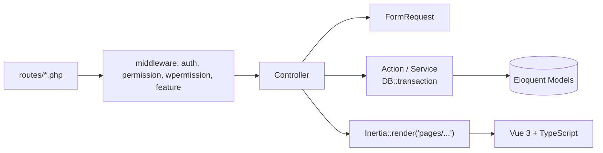

<!-- prettier-ignore -->
<div align="center">


# e-Surat

**Sistem manajemen surat elektronik untuk instansi pemerintah, perusahaan swasta, BUMN/BUMD, perguruan tinggi/sekolah, serta organisasi atau individu.**

[](https://github.com/msbhdn/e-surat/actions/workflows/tests.yml)


[](https://opensource.org/licenses/MIT)

[Ikhtisar](#ikhtisar) • [Fitur](#fitur) • [Memulai](#memulai) • [Arsitektur](#arsitektur) • [Konfigurasi](#konfigurasi) • [Testing](#testing) • [Deployment](#deployment) • [Security](#security) • [Contributors](#contributors)

</div>

e-Surat mengelola siklus hidup surat resmi dalam satu aplikasi: penyusunan dan pengiriman surat, kotak masuk utama dan undangan, disposisi, nota dinas, arsip, sampai master data pengguna, jabatan, role, dan klasifikasi arsip.

Dibangun dengan **Laravel 13 + Inertia 3 + Vue 3 (TypeScript)**. Satu codebase melayani banyak instansi; setiap environment produksi mewakili satu instansi dengan database, storage, queue, dan kredensial sendiri.

> [!TIP]
> Ingin mencoba cepat? Jalankan `composer setup` lalu `composer dev`. Aplikasi tersedia di `http://127.0.0.1:8000`.

## Ikhtisar

Alur utama aplikasi:

1. **Compose** — surat disusun dengan nomor agenda otomatis dari `RefAgendaSurat` dan kode klasifikasi, lalu dikirim ke jabatan penerima.
2. **Distribusi** — surat masuk utama dan undangan muncul di inbox penerima, lengkap dengan detail surat dan timeline.
3. **Tindak lanjut** — penerima membuat disposisi atau nota dinas; surat dapat ditutup setelah selesai.
4. **Arsip** — surat masuk yang sudah ditutup tersedia sebagai arsip baca-saja dengan metadata TNDE dan riwayat audit.

Notifikasi menghubungkan seluruh alur tersebut: setiap surat, disposisi, dan nota dinas baru dapat dikirim ke pusat notifikasi, web push, email, dan Telegram sesuai feature gate environment.

## Fitur

- **Penyusunan surat** — compose dengan nomor agenda otomatis, penerima, dokumen lampiran, dan riwayat aktivitas. Surat terkirim dapat diedit per bagian: isi, penerima, dan dokumen.
- **Kotak masuk** — surat masuk utama dan undangan dengan pencarian, filter status baca, pagination, detail surat, dan timeline penerima. Membuka surat menandai `read_at` item.
- **Disposisi** — disposisi per surat, termasuk disposisi khusus per pengguna, dengan catatan, follow-up, dan timeline.
- **Nota dinas** — pembuatan nota, penutupan surat (`close`), catatan, dan timeline.
- **Arsip** — surat masuk berstatus `close` (baca-saja), pencarian, metadata TNDE, riwayat audit, dan lampiran privat.
- **Notifikasi** — pusat notifikasi (bell + riwayat) untuk surat masuk/undangan, disposisi, dan nota dinas. Kanal database, web push, email, dan Telegram; klasifikasi SR/R/T hanya database + web push. Status baca notifikasi dan item disinkronkan dua arah, dan tautan eksternal melewati endpoint `notifications.open`.
- **Master data** — pengguna, jabatan, role & permission, kode klasifikasi arsip, dan follow-up.
- **Dashboard** — statistik ringkas dan chart.
- **Autentikasi** — Laravel Fortify: email/password, verifikasi email, 2FA (TOTP + recovery code), dan passkeys.
- **Otorisasi** — spatie/laravel-permission dengan middleware `permission`, `role`, dan `wpermission` (wildcard, mis. `master.*`).
- **UX** — badge inbox di sidebar (cache 30 detik per jabatan aktif), bell notifikasi, toast, dan tema terang/gelap.
- **Operasional** — feature gate per environment, lampiran privat, serta deployment Docker + FrankenPHP atau Laravel Cloud.

## Tech Stack

| Lapisan       | Teknologi                                                                                                                |
| ------------- | ------------------------------------------------------------------------------------------------------------------------ |
| Backend       | PHP ^8.3, Laravel ^13, Inertia ^3, Laravel Fortify, spatie/laravel-permission, Ziggy                                     |
| Frontend      | Vue 3.5 (Composition API + `<script setup>`), TypeScript, Inertia Vue, Tailwind CSS 4, reka-ui, Unovis, GSAP, vue-sonner |
| Build         | Vite+ (`vp`); `vite` di-override ke `@voidzero-dev/vite-plus-core`; SSR dinonaktifkan                                    |
| Database      | Default SQLite; MySQL/PostgreSQL didukung lewat `.env`                                                                   |
| Queue         | Database queue; worker mendengarkan `notifications,default`                                                              |
| Notifikasi    | Database, Web Push (VAPID), email, dan Telegram                                                                          |
| Kualitas kode | Pest 4, Larastan (PHPStan), Pint, `vue-tsc`                                                                              |

## Arsitektur

MVC dengan lapisan **Action** tipis untuk logika bisnis. Controller menangani HTTP, validasi lewat FormRequest, lalu mendelegasikan operasi ke Action.



- **Route modular** — `routes/web.php` memuat `memo.php`, `disposition.php`, `inbox.php`, `arsip.php`, `master.php`, `notifications.php`, dan `settings.php`. Otorisasi sepenuhnya lewat middleware per-route, tanpa Policy.
- **Action layer** — operasi tulis inti (surat + nomor agenda + penerima + dokumen, disposisi, nota dinas) dibungkus `DB::transaction`.
- **Inertia props** — controller mengembalikan props bertipe; daftar memakai `paginate(15)->withQueryString()` dan pencarian `whereLike`.
- **Tipe bersama** — `resources/js/types/models/*` harus diperbarui bersamaan dengan props backend, jika tidak `npm run types:check` gagal.
- **Feature gate** — fitur opsional (`email`, `telegram`, `webpush`) dipilih per environment lewat `COMPANY_FEATURES`; fitur yang tidak aktif mati secara fail-closed.

## Modul & Akses

| Modul                  | Route file          | Permission                                                                                                 |
| ---------------------- | ------------------- | ---------------------------------------------------------------------------------------------------------- |
| Surat (compose & sent) | `web.php`           | `compose.create`, `compose.store`, `sent.index`, `sent.show`, `sent.edit`, `sent.update`                   |
| Kotak masuk            | `inbox.php`         | `primary.index`, `primary.show`, `undangan.index`, `undangan.show`                                         |
| Notifikasi             | `notifications.php` | Cukup `auth`; data dibatasi ke notifikasi milik user                                                       |
| Nota dinas             | `memo.php`          | `memo.index`, `memo.show`, `memo.create`, `memo.store`, `memo.close`                                       |
| Disposisi              | `disposition.php`   | `disposition.index`, `disposition.show`, `disposition.create`, `disposition.store`                         |
| Arsip                  | `arsip.php`         | `arsip.index`, `arsip.show`                                                                                |
| Master data            | `master.php`        | `master.pengguna`, `master.jabatan`, `master.klasifikasi`, `master.followup`; index `wpermission:master.*` |
| Settings               | `settings.php`      | Cukup `auth`; update password memakai `RequirePassword` dan throttle `6,1`                                 |

## Struktur Proyek

```text
.
├── .github/              # Workflow CI, Dependabot, template issue/PR
├── app/
│   ├── Actions/          # Logika bisnis per domain: Letter, Memo, Disposition, Notification, MasterData, …
│   ├── Http/             # Controller, FormRequest, middleware
│   ├── Models/           # Eloquent (tabel berbahasa Indonesia)
│   ├── Notifications/    # InboxItemNotification + channel Telegram
│   └── Services/         # CompanyFeature, NotificationCenter, storage, akses, cache
├── routes/               # web.php + modul per domain
├── resources/js/         # Halaman Inertia, komponen, composable, tipe TypeScript
├── tests/                # Pest: Unit/ dan Feature/
├── CHANGELOG.md          # Riwayat perubahan
├── CODE_OF_CONDUCT.md    # Standar perilaku komunitas
├── CONTRIBUTING.md       # Panduan kontribusi
├── LICENSE               # Lisensi MIT
├── SECURITY.md           # Kebijakan pelaporan kerentanan
├── docs/                 # Panduan deployment dan runbook
├── deploy/               # Docker, systemd, dan script operasional
└── public/               # Document root; sw.js untuk web push
```

## Memulai

### Kebutuhan

- PHP **^8.3** (CI memakai 8.4) dan Composer 2.
- Node **26** dan npm. CI dan image memakai Node 26; gunakan lockfile npm, bukan pnpm/yarn.
- SQLite (default), MySQL, atau PostgreSQL.

### Instalasi cepat

```bash
git clone https://github.com/msbhdn/e-surat.git
cd e-surat

composer setup
php artisan db:seed --class=DatabaseSeeder   # opsional
composer dev
```

`composer setup` menjalankan `composer install`, menyalin `.env`, membuat `APP_KEY`, migrasi database, `npm install`, dan build frontend.

> [!WARNING]
> `DatabaseSeeder` membuat akun `superadmin` dengan password `password` dan email kosong (login memakai username). Ganti password setelah login pertama.

> [!NOTE]
> Untuk data contoh lokal, jalankan `php artisan db:seed --class=DemoDataSeeder` setelah `DatabaseSeeder`. Akun demo: `pengelola`, `pengguna1`, dan `pengguna2` — semuanya memakai password `password`.

<details>
<summary>Instalasi manual</summary>

```bash
composer install
cp .env.example .env
php artisan key:generate
php artisan migrate
npm install
npm run build
```

</details>

### Menjalankan development

```bash
composer dev
```

Perintah tersebut menjalankan tiga proses sekaligus: `php artisan serve`, `php artisan queue:listen --queue=notifications,default`, dan Vite dev server. Aplikasi diakses di `http://127.0.0.1:8000`.

### Perintah penting

| Perintah                              | Fungsi                                                                        |
| ------------------------------------- | ----------------------------------------------------------------------------- |
| `composer setup`                      | Bootstrap lengkap: install, `.env`, key, migrate, npm install, build          |
| `composer dev`                        | Server + queue worker + Vite dev server                                       |
| `npm run dev`                         | Vite dev server saja                                                          |
| `npm run build`                       | Build produksi ke `public/build`                                              |
| `npm run check` / `check:fix`         | Lint + format TS/Vue (`vp check`)                                             |
| `npm run types:check`                 | Type-check frontend (`vue-tsc --noEmit`)                                      |
| `composer lint` / `lint:check`        | Pint (format / cek tanpa mengubah file)                                       |
| `composer types:check`                | PHPStan (Larastan)                                                            |
| `composer test`                       | `config:clear` → `lint:check` → `types:check` → `php artisan test`            |
| `composer ci:check`                   | Yang dijalankan CI: `npm run check` → `npm run types:check` → `composer test` |
| `php artisan company:validate-config` | Preflight feature/ruleset sebelum deploy                                      |

## Konfigurasi

| Variabel                                                    | Fungsi                                                                                 |
| ----------------------------------------------------------- | -------------------------------------------------------------------------------------- |
| `APP_URL`, `APP_KEY`                                        | URL publik dan kunci aplikasi; `APP_KEY` unik per environment.                         |
| `COMPANY_KEY`, `COMPANY_FEATURES`, `COMPANY_RULESET`        | Identitas instansi, feature gate (`email`, `telegram`, `webpush`), dan ruleset bisnis. |
| `DB_*`, `CACHE_STORE`, `SESSION_DRIVER`, `QUEUE_CONNECTION` | Database, cache/session, dan queue persisten.                                          |
| `FILESYSTEM_DISK`                                           | Disk privat lampiran: volume `local` atau bucket `s3`.                                 |
| `MAIL_*`                                                    | Kanal email untuk feature `email`.                                                     |
| `TELEGRAM_*`                                                | Bot dan secret webhook untuk feature `telegram`.                                       |
| `VAPID_*`                                                   | Kunci Web Push untuk feature `webpush`.                                                |

> [!IMPORTANT]
> Feature gate bersifat fail-closed: fitur yang tidak tercantum di `COMPANY_FEATURES` tidak aktif. Feature `email` mensyaratkan mailer nyata (bukan `log`/`array`) dan `MAIL_FROM_ADDRESS`; `telegram` memerlukan token, username, dan secret; `webpush` memerlukan VAPID dan `APP_URL` HTTPS. Jalankan `php artisan company:validate-config` sebelum deploy.

- **Telegram** — setelah `TELEGRAM_*` terisi dan `APP_URL` HTTPS publik, daftarkan webhook dengan `php artisan telegram:webhook:set`. Route webhook: `POST /telegram/webhook`.
- **Notifikasi eksternal** — email, Telegram, dan web push dikirim lewat queue `notifications`. Worker harus mendengarkan `--queue=notifications,default` (sudah diset di `composer dev` dan `compose.yml`).
- **Lampiran** — disimpan di disk privat. Jangan memakai `php artisan storage:link` atau disk `public`; akses hanya lewat endpoint unduhan/pratinjau yang memeriksa izin.

## Testing

Backend memakai **Pest 4** dengan SQLite in-memory. `phpunit.xml` memaksa `DB_CONNECTION=sqlite` dan `:memory:`, jadi test aman dijalankan kapan saja tanpa menyentuh database development.

```bash
php artisan test                              # seluruh suite
php artisan test --filter=AuthenticationTest  # satu test
php artisan test tests/Feature/Auth/          # satu direktori
composer test                                 # lint + PHPStan + Pest
composer ci:check                             # yang dijalankan CI
```

Cakupan saat ini: auth, settings, dashboard, pusat notifikasi (termasuk sinkronisasi read state dan tautan eksternal), cache badge inbox, dan cache permission. Domain inti e-surat (surat, nota dinas, disposisi, arsip, master data) masih minim test — tambahkan Feature test saat mengubah alur tersebut.

## Deployment

Satu environment produksi melayani satu instansi. Image dan tag sama untuk semua instansi; database, cache/session, queue, storage, secret, dan domain terpisah. Aplikasi tidak memakai `company_id` atau global scope tenant — isolasi dilakukan di level environment.

- **[Panduan deployment](docs/deployment.md)** — kontrak environment, bootstrap, storage, queue, dan aturan rilis.
- **[Runbook Docker + FrankenPHP](docs/runbook-docker-frankenphp.md)** — topologi, prasyarat host, dan langkah rollout.

```bash
cp deploy/docker/.env.example .env
docker compose run --rm app php artisan company:validate-config
docker compose run --rm app php artisan migrate --force
docker compose run --rm app php artisan db:seed --class=DatabaseSeeder
docker compose up -d
```

> [!IMPORTANT]
> `APP_ENV=production`, `APP_DEBUG=false`, dan `COMPANY_KEY` wajib diisi. Entrypoint container akan berhenti sebelum melayani trafik bila konfigurasi company tidak valid atau storage host tidak writable.

Catatan operasional:

- Lampiran disimpan di `DATA_PATH/storage/app/private` (volume host) atau bucket privat (`FILESYSTEM_DISK=s3`).
- `public/build` tidak di-commit; image membangunnya pada stage Node 26.
- `php artisan route:cache` belum bisa dipakai karena beberapa route berupa closure; gunakan `config:cache`.
- Worker queue harus mendengarkan `notifications,default` agar email, Telegram, dan web push terkirim.

## Security

Laporkan kerentanan secara privat melalui [SECURITY.md](SECURITY.md). Jangan membuka issue publik untuk masalah keamanan.

## Contributors

Terima kasih kepada semua yang membantu membuat e-Surat lebih baik.

Menemukan bug, aturan yang terlewat, atau masalah saat instalasi? [Buka issue](https://github.com/msbhdn/e-surat/issues). Ketentuan pull request ada di [`CONTRIBUTING.md`](CONTRIBUTING.md), dan perilaku di issue serta pull request diatur oleh [`CODE_OF_CONDUCT.md`](CODE_OF_CONDUCT.md).

## Changelog

Lihat [`CHANGELOG.md`](CHANGELOG.md) untuk riwayat perubahan. Rilis bertag juga tersedia di [GitHub Releases](https://github.com/msbhdn/e-surat/releases).

## License

Dirilis di bawah lisensi [MIT](LICENSE). Deklarasi lisensi juga tersedia di [`composer.json`](composer.json).
