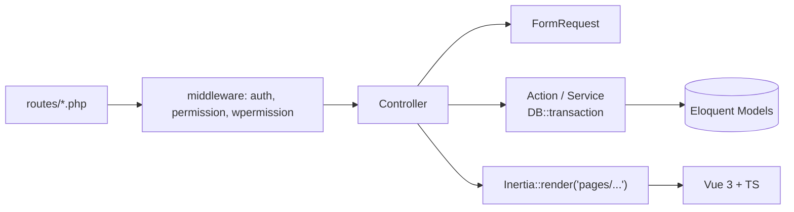

# e-Surat

Sistem manajemen surat elektronik untuk instansi pemerintah. Mengelola siklus hidup surat resmi — penyusunan dan pengiriman surat, nota dinas, disposisi, kotak masuk (surat masuk & undangan), arsip, sampai master data pengguna/jabatan/role.

[](https://github.com/msbhdn/e-surat/actions/workflows/tests.yml)


## Fitur

| Modul            | Isi                                                                                                                                                                                                               |
| ---------------- | ----------------------------------------------------------------------------------------------------------------------------------------------------------------------------------------------------------------- |
| Penyusunan surat | Compose surat dengan nomor agenda otomatis (dari `RefAgendaSurat` + kode klasifikasi), penerima, dokumen lampiran, dan riwayat aktivitas. Surat terkirim (`sent`) bisa diedit per bagian: isi, penerima, dokumen. |
| Kotak masuk      | Surat masuk utama dan undangan: tabel dengan pencarian, filter status baca, pagination, dan detail surat + timeline penerima. Surat yang belum dibaca otomatis ditandai terbaca saat dibuka.                      |
| Nota dinas       | Daftar nota dinas dengan pencarian/filter, pembuatan nota, dan penutupan (`close`) nota.                                                                                                                          |
| Disposisi        | Disposisi per surat, termasuk disposisi khusus per pengguna, dengan timeline.                                                                                                                                     |
| Arsip            | Kerangka halaman `/archive` — daftar arsip **belum diimplementasikan** (masih `PlaceholderPattern`).                                                                                                              |
| Master data      | Pengguna, jabatan, role & permission, kode klasifikasi arsip, dan follow-up.                                                                                                                                      |
| Dashboard        | Statistik ringkas dan data chart.                                                                                                                                                                                 |
| Autentikasi      | Laravel Fortify: email/password, verifikasi email, 2FA (TOTP + recovery code), passkeys.                                                                                                                          |
| Otorisasi        | spatie/laravel-permission (RBAC) dengan middleware `permission`, `role`, dan `wpermission` (wildcard, mis. `master.*`).                                                                                           |
| UX               | Badge jumlah inbox di sidebar (di-cache 30 detik per jabatan aktif), toast, tema terang/gelap.                                                                                                                    |

## Tech Stack

| Lapisan       | Teknologi                                                                                                      |
| ------------- | -------------------------------------------------------------------------------------------------------------- |
| Backend       | PHP ^8.3, Laravel ^13, Inertia ^3, Laravel Fortify, spatie/laravel-permission, Ziggy                           |
| Frontend      | Vue 3 (Composition API + `<script setup>`), TypeScript, Inertia Vue, Tailwind CSS 4, reka-ui, GSAP, vue-sonner |
| Build         | Vite+ (`vp`) — `vite` di-override ke `@voidzero-dev/vite-plus-core`; SSR dinonaktifkan                         |
| Database      | Default SQLite; MySQL/PostgreSQL didukung lewat `.env`                                                         |
| Kualitas kode | Pest 4, Larastan (PHPStan), Pint, `vue-tsc`                                                                    |

## Kebutuhan Sistem

- PHP **^8.3** (CI memakai 8.4), Composer 2
- Node **22+** dan npm (lockfile npm — jangan pakai pnpm/yarn)
- Database: SQLite (default, file `database/database.sqlite`) atau MySQL/PostgreSQL

## Instalasi

### Cara cepat (satu perintah)

```bash
composer setup
```

Perintah tersebut menjalankan `composer install` → salin `.env` → `key:generate` → `migrate --force` → `npm install` → `npm run build`.

### Manual

```bash
git clone https://github.com/msbhdn/e-surat.git
cd e-surat

composer install
cp .env.example .env
php artisan key:generate
php artisan migrate    # SQLite: file database/database.sqlite dibuat otomatis

npm install
npm run build          # wajib: public/build tidak di-track (gitignored)
```

### Data awal (opsional)

```bash
php artisan migrate
php artisan db:seed --class=DatabaseSeeder   # permission + master data + admin default
```

`DatabaseSeeder` membuat administrator default yang sama di semua server:

| Field    | Nilai                            |
| -------- | -------------------------------- |
| Username | `superadmin`                     |
| Name     | `Super Administrator`            |
| Password | `password` (ganti setelah login) |
| Email    | kosong (login memakai username)  |

Ganti password setelah login pertama. Seeder idempotent dan tidak mereset
password yang sudah diganti. Master data awal (role, jabatan, tindak lanjut,
klasifikasi) sama untuk semua perusahaan dan disesuaikan lewat UI Master Data.
Untuk data contoh di lingkungan lokal saja, jalankan
`php artisan db:seed --class=DemoDataSeeder` (akun demo memakai password `password`).

## Menjalankan Development

```bash
composer dev
```

Menjalankan tiga proses sekaligus via `concurrently`: `php artisan serve`, `php artisan queue:listen` (queue driver `database`), dan `npm run dev` (Vite dev server). Aplikasi diakses di `http://127.0.0.1:8000`.

## Perintah Penting

| Perintah                              | Fungsi                                                                         |
| ------------------------------------- | ------------------------------------------------------------------------------ |
| `composer setup`                      | Bootstrap lengkap dari nol (install, `.env`, key, migrate, npm install, build) |
| `composer dev`                        | Server + queue worker + Vite dev server                                        |
| `npm run dev`                         | Vite dev server saja                                                           |
| `npm run build`                       | Build produksi ke `public/build`                                               |
| `npm run check` / `check:fix`         | Lint + format TS/Vue (`vp check`)                                              |
| `npm run types:check`                 | Type-check frontend (`vue-tsc --noEmit`)                                       |
| `composer lint` / `lint:check`        | Pint (format / cek tanpa mengubah file)                                        |
| `composer types:check`                | PHPStan (Larastan)                                                             |
| `composer test`                       | `config:clear` → `lint:check` → `types:check` → `php artisan test`             |
| `composer ci:check`                   | Yang dijalankan CI: `npm run check` → `npm run types:check` → `composer test`  |
| `php artisan company:validate-config` | Preflight feature/ruleset sebelum deploy                                       |

## Arsitektur

MVC dengan lapisan **Action** tipis untuk logika bisnis. Controller hanya memvalidasi lewat FormRequest dan mendelegasikan ke Action.



- **Route modular**: `routes/web.php` memuat `memo.php`, `disposition.php`, `inbox.php`, `arsip.php`, `master.php`, `settings.php`. Otorisasi sepenuhnya lewat middleware per-route (tanpa Policy).
- **Inertia props**: controller mengembalikan props bertipe (termasuk `breadcrumbItems`); daftar memakai `paginate(15)->withQueryString()` dan pencarian `whereLike`.
- **Transaksi**: penulisan inti (surat + nomor agenda + penerima + dokumen) dibungkus `DB::transaction` di Action.
- **Tipe bersama**: `resources/js/types/models/*` harus diperbarui bersamaan dengan props backend, jika tidak `npm run types:check` gagal.

## Struktur Direktori

```text
.
├── app/
│   ├── Actions/                 # Logika bisnis: Letter, Memo, Disposition, Dashboard, MasterData, Fortify
│   ├── Http/
│   │   ├── Controllers/         # Controller tipis (MasterData/, Inbox/, Settings/)
│   │   ├── Middleware/          # HandleInertiaRequests, HandleAppearance, WildcardPermissionMiddleware, CompanyFeatureMiddleware
│   │   └── Requests/            # Satu FormRequest per operasi tulis
│   ├── Models/                  # Eloquent: letters, memo, dispositions, ref_agenda_surat, ref_kd_klasifikasi, …
│   ├── Console/Commands/        # company:validate-config, letter-docs:migrate-storage
│   └── Services/                # CompanyFeature, LetterDocStorage, LetterAccess, LetterActivityService, cache
├── bootstrap/app.php            # Alias middleware + web stack
├── database/                    # Migrations, seeders (Permissions, MasterDataSeeder), factories
├── public/                      # Document root; public/build hasil build (tidak di-track)
├── resources/
│   ├── css/app.css
│   └── js/
│       ├── components/          # Shared components + ui/ (gaya shadcn/reka-ui, jangan diedit manual)
│       ├── composables/         # usePermissions, useAppearance, useFormattedDate, useDecades, …
│       ├── layouts/             # Layout Inertia
│       ├── pages/               # app/{sent,memo,disposition,primary,undangan}, archive, master, settings, auth
│       └── types/               # Tipe model TypeScript (selaras dengan props backend)
├── routes/                      # web.php + modul per domain
├── storage/
└── tests/                       # Pest: Unit/, Feature/{Auth,Settings}
```

## Routing & Hak Akses

| Modul                  | Route file        | Permission middleware                                                                                              |
| ---------------------- | ----------------- | ------------------------------------------------------------------------------------------------------------------ |
| Surat (compose & sent) | `web.php`         | `compose.create`, `compose.store`, `sent.index`, `sent.show`, `sent.edit`                                          |
| Kotak masuk            | `inbox.php`       | `primary.index`, `primary.show`, `undangan.index`, `undangan.show`                                                 |
| Nota dinas             | `memo.php`        | `memo.index`, `memo.show`, `memo.create`, `memo.store`, `memo.close`                                               |
| Disposisi              | `disposition.php` | `disposition.index`, `disposition.show`, `disposition.create`, `disposition.store`                                 |
| Arsip                  | `arsip.php`       | Cukup `auth` (halaman masih placeholder)                                                                           |
| Master data            | `master.php`      | `master.pengguna`, `master.jabatan`, `master.klasifikasi`, `master.followup`; index memakai `wpermission:master.*` |
| Settings               | `settings.php`    | Cukup `auth` (profil, password, tampilan, keamanan)                                                                |

## Testing

Backend memakai **Pest 4** dengan SQLite in-memory (`phpunit.xml` memaksa `DB_CONNECTION=sqlite`, `:memory:`), jadi aman dijalankan kapan saja tanpa menyentuh database development.

```bash
php artisan test                              # seluruh suite
php artisan test --filter=AuthenticationTest  # satu file
php artisan test tests/Feature/Auth/          # satu direktori
composer test                                 # lint + PHPStan + Pest
```

Cakupan saat ini: alur auth, settings, dashboard, cache badge inbox, dan cache permission. Domain inti e-surat (surat, nota dinas, disposisi, arsip, master data) masih minim test — tambahkan Feature test saat mengubah alur tersebut.

## Deployment

Satu server melayani satu perusahaan. Image/tag sama untuk semua perusahaan;
perbedaan hanya pada environment (feature, ruleset, port/domain, storage).
Dua jalur:

- **Docker + FrankenPHP (VM Ubuntu, default):** image dibangun sekali per tag
  oleh `.github/workflows/release.yml`, rollout manual. Mulai dari
  [`docs/runbook-docker-frankenphp.md`](docs/runbook-docker-frankenphp.md).
- **Laravel Cloud:** satu environment per perusahaan, bucket privat + managed
  worker. Lihat [`docs/deployment.md`](docs/deployment.md).

```bash
cp deploy/docker/.env.example .env     # isi COMPANY_*, DB, mail, port/domain
docker compose run --rm app php artisan company:validate-config
docker compose run --rm app php artisan migrate --force
docker compose run --rm app php artisan db:seed --class=DatabaseSeeder   # termasuk admin default
docker compose up -d
```

Catatan:

- Lampiran surat disimpan di disk privat default: volume host
  `DATA_PATH/storage/app/private` (mode VM) atau bucket privat (`FILESYSTEM_DISK=s3`).
  Hanya endpoint unduhan/pratinjau yang memeriksa akses yang menyajikan file; jangan
  memakai `php artisan storage:link`.
- `public/build` sengaja **tidak di-commit** (lihat `.gitignore`); image
  membangunnya pada stage Node 26.
- `php artisan route:cache` belum bisa dipakai karena beberapa route
  didefinisikan sebagai closure; gunakan `config:cache` saja (dijalankan
  entrypoint container).
- File `.env` produksi perlu `APP_ENV=production`, `APP_DEBUG=false`,
  `COMPANY_KEY`, `COMPANY_FEATURES`, `COMPANY_RULESET`,
  kredensial database/cache/queue, dan konfigurasi mail.
- `php artisan company:validate-config` wajib lulus sebelum container melayani
  trafik; feature/ruleset yang tidak dikenal menghentikan start. Feature `email`
  mensyaratkan mailer nyata dan `MAIL_FROM_ADDRESS`.

## Lisensi

MIT — sesuai deklarasi `composer.json`.
