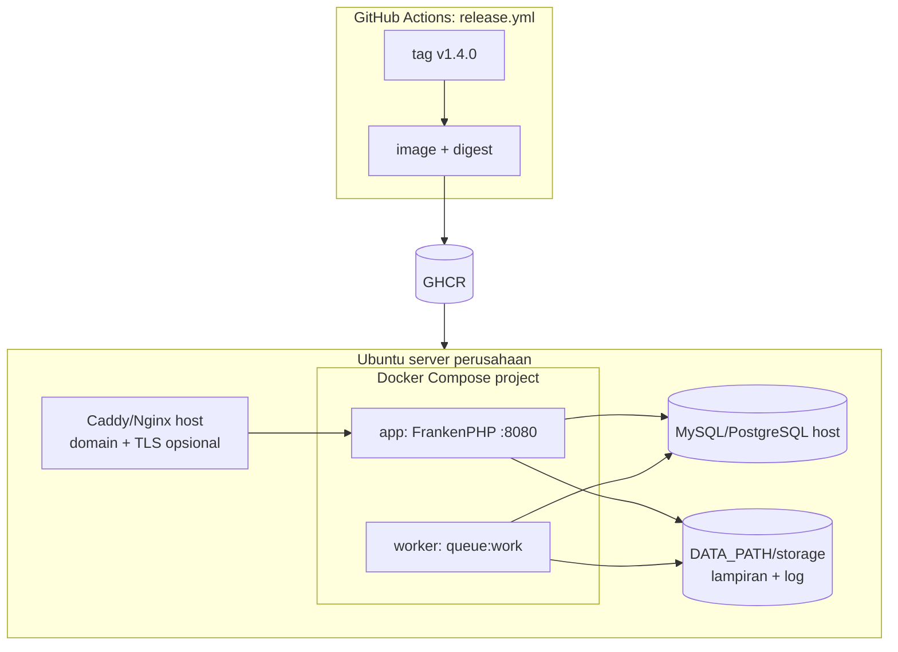

# Runbook Docker + FrankenPHP (satu server Ubuntu per perusahaan)

Runbook ini menggantikan langkah tarball/SSH. Image dibangun sekali per tag oleh
`.github/workflows/release.yml`; rollout, konfigurasi, dan clone dilakukan
manual di server. Port, domain/IP, dan path data boleh berbeda per perusahaan —
image-nya tetap sama.

## 1. Topologi



| Komponen            | Milik siapa       | Catatan                                           |
| ------------------- | ----------------- | ------------------------------------------------- |
| Image               | release train     | sama untuk semua perusahaan, tag/digest immutable |
| `.env`              | server perusahaan | berisi `COMPANY_*`, DB, mail, Telegram, port      |
| Database            | server perusahaan | satu DB per perusahaan                            |
| `DATA_PATH/storage` | server perusahaan | lampiran privat + log                             |
| Port/domain         | server perusahaan | bebas berbeda; lihat §3                           |
| Secret              | operator          | file `.env` mode `600`, bukan di image            |

## 2. Prasyarat host

- Ubuntu 22.04/24.04 LTS, akses `sudo`, waktu tersinkron (NTP).
- Docker Engine + plugin Compose v2:

```bash
sudo apt-get update
sudo apt-get install -y ca-certificates curl gnupg
sudo install -m 0755 -d /etc/apt/keyrings
curl -fsSL https://download.docker.com/linux/ubuntu/gpg | sudo gpg --dearmor -o /etc/apt/keyrings/docker.gpg
echo "deb [arch=$(dpkg --print-architecture) signed-by=/etc/apt/keyrings/docker.gpg] https://download.docker.com/linux/ubuntu $(. /etc/os-release && echo $VERSION_CODENAME) stable" \
  | sudo tee /etc/apt/sources.list.d/docker.list >/dev/null
sudo apt-get update
sudo apt-get install -y docker-ce docker-ce-cli containerd.io docker-buildx-plugin docker-compose-plugin
sudo systemctl enable --now docker
```

- Database di host (contoh MySQL/MariaDB) dan user khusus. User butuh dua
  titik masuk: `172.%` untuk aplikasi (dari bridge Docker) dan `localhost`
  untuk skrip backup terjadwal di host (§11):

```sql
CREATE DATABASE esurat_company_a CHARACTER SET utf8mb4 COLLATE utf8mb4_unicode_ci;
CREATE USER 'esurat'@'172.%' IDENTIFIED BY '<password-kuat>';
CREATE USER 'esurat'@'localhost' IDENTIFIED BY '<password-kuat>';
GRANT ALL PRIVILEGES ON esurat_company_a.* TO 'esurat'@'172.%';
GRANT SELECT, LOCK TABLES, EVENT ON esurat_company_a.* TO 'esurat'@'localhost';
FLUSH PRIVILEGES;
```

Container menjangkau service di host lewat `host.docker.internal` (compose
menambahkan `host-gateway`), bukan `127.0.0.1`. Agar MariaDB menerima koneksi
dari bridge Docker tanpa membuka 3306 ke publik:

```ini
# /etc/mysql/mariadb.conf.d/99-docker.cnf
[mysqld]
bind-address = 0.0.0.0
```

```bash
sudo systemctl restart mariadb
sudo ufw deny 3306
sudo ufw allow from 172.16.0.0/12 to any port 3306 proto tcp
sudo ufw reload
```

Alternatif yang lebih ketat: pasang MariaDB sebagai service compose dengan
volume sendiri, lalu set `DB_HOST=db`. Jangan memakai `network_mode: host` untuk
beberapa perusahaan pada satu host karena semua container akan berebut port.

- Firewall: buka `80/443` bila memakai domain + TLS, atau `APP_HTTP_PORT` bila
  akses langsung lewat IP. Jangan membuka port database ke publik.
- Git hanya dibutuhkan untuk clone compose/Dockerfile/runbook, bukan untuk
  build di server (kecuali mode air-gapped, §6B).

## 3. Port dan domain

Container selalu HTTP di `:8080`. Pilihan topologi diatur lewat `.env`:

| Topologi                    | `APP_BIND_IP` | `APP_HTTP_PORT`   | `APP_URL`                                   | TLS           |
| --------------------------- | ------------- | ----------------- | ------------------------------------------- | ------------- |
| Domain + reverse proxy host | `127.0.0.1`   | `8080` (internal) | `https://esurat.company-a.example.com`      | di proxy host |
| IP + port langsung          | `0.0.0.0`     | mis. `8081`       | `http://203.0.113.10:8081`                  | tidak ada     |
| Domain tanpa TLS (staging)  | `0.0.0.0`     | mis. `8082`       | `http://staging.company-a.example.com:8082` | tidak ada     |

Setiap topologi memercayai set header `X-Forwarded-*` yang berbeda
(`TRUSTED_PROXIES` di `.env`, dipisah koma):

- **Domain + proxy host (Caddy/Nginx → `127.0.0.1:8080`)**: koneksi masuk ke
  container lewat docker-proxy/gateway bridge, jadi header dari proxy baru
  dipercaya bila rentang bridge ikut dipercaya:
  `TRUSTED_PROXIES=127.0.0.1,::1,172.16.0.0/12`. Tanpa itu, IP klien di log
  audit selalu `172.x.x.x` dan skema https tidak terdeteksi.
- **IP + port langsung (tanpa proxy)**: tidak ada proxy yang jujur di depan
  klien — kosongkan: `TRUSTED_PROXIES=127.0.0.1,::1` (default). Header
  `X-Forwarded-*` dari klien mana pun diabaikan, jadi kepalan `https`/IP
  tidak bisa dipalsukan.
- **Domain tanpa TLS (staging)**: sama dengan mode IP langsung —
  `TRUSTED_PROXIES` default, kecuali proxy-nya memang meneruskan header dan
  Anda ingin skema/`Host` dari proxy.

Aturan:

- `APP_URL` harus sama dengan URL yang dipakai browser; salah isi menyebabkan
  redirect login/cookie gagal.
- `SESSION_SECURE_COOKIE=true` hanya untuk HTTPS. Untuk mode HTTP set `false`.
- Beberapa perusahaan pada satu host: setiap project memakai
  `APP_HTTP_PORT` berbeda dan `DATA_PATH` berbeda (§13).

Contoh reverse proxy Caddy di host (`/etc/caddy/Caddyfile`):

```caddyfile
esurat.company-a.example.com {
	encode zstd br gzip
	# Kunci transport ke HTTPS setelah kunjungan pertama (anti SSL-strip),
	# plus header keamanan dasar untuk aplikasi surat resmi.
	header {
		Strict-Transport-Security "max-age=31536000"
		X-Content-Type-Options "nosniff"
		-Server
	}
	reverse_proxy 127.0.0.1:8080
}
```

Caddy mengurus sertifikat otomatis (butuh DNS A/AAAA ke server dan port 80/443
terbuka). Nginx setara: `proxy_set_header Host $host;`,
`X-Forwarded-Proto $scheme;`, `X-Forwarded-For $proxy_add_x_forwarded_for;`.
Aplikasi sudah mempercayai proxy loopback (`127.0.0.1`, `::1`).

## 4. Layout direktori dan kepemilikan

```text
/srv/esurat/
├── app/                 # clone repository (compose.yml, Dockerfile, .env)
├── data/
│   ├── storage/         # PERSISTEN: lampiran privat + log
│   └── backups/         # dump DB & arsip storage
└── caddy/               # opsional: data/config Caddy host
```

```bash
sudo mkdir -p /srv/esurat/app /srv/esurat/data/storage /srv/esurat/data/backups
sudo chown -R 1000:1000 /srv/esurat/data/storage
sudo chmod 750 /srv/esurat/data
```

Container berjalan sebagai UID/GID `1000`. Jika user deploy di host bukan 1000,
tetap gunakan `chown 1000:1000` pada `DATA_PATH/storage`; jangan menjalankan
container sebagai root.

## 5. Menyiapkan `.env`

```bash
cd /srv/esurat/app
git clone --branch v1.4.0 --depth 1 https://github.com/msbhdn/e-surat.git .
cp deploy/docker/.env.example .env
chmod 600 .env
```

Isi minimal yang wajib benar:

```dotenv
COMPANY_KEY=company-a
# Feature opsional: email, telegram, webpush. Kosong = semua feature mati.
COMPANY_FEATURES=
COMPANY_RULESET=default

RELEASE=v1.4.0
ESURAT_IMAGE=ghcr.io/msbhdn/e-surat:v1.4.0
DATA_PATH=/srv/esurat/data
APP_BIND_IP=127.0.0.1
APP_HTTP_PORT=8080

APP_URL=https://esurat.company-a.example.com
APP_KEY=
SESSION_SECURE_COOKIE=true
SESSION_COOKIE=esurat_company_a
DB_CONNECTION=mysql
DB_HOST=host.docker.internal
DB_DATABASE=esurat_company_a
DB_USERNAME=esurat
DB_PASSWORD=<password>
FILESYSTEM_DISK=local

# Default: email ditulis ke log, tidak dikirim.
MAIL_MAILER=log
MAIL_FROM_ADDRESS=no-reply@company-a.example.com
```

```bash
# APP_KEY unik per perusahaan; jangan menyalin dari server lain.
docker run --rm --entrypoint php ghcr.io/msbhdn/e-surat:v1.4.0 artisan key:generate --show
# atau bila image belum ada: php artisan key:generate --show pada host dengan PHP 8.4
```

`--entrypoint php` dipakai agar entrypoint produksi (yang mewajibkan `APP_KEY`)
tidak dijalankan saat menghasilkan key.

Setelah `.env` diisi, muat variabelnya ke shell (dipakai perintah `curl` dan
`docker compose` di bawah) lalu validasi sintaks compose:

```bash
set -a; . ./.env; set +a
docker compose config >/dev/null && echo "compose OK"
```

Compose sendiri membaca `.env`; sourcing hanya agar `${APP_HTTP_PORT}` dan
`${DATA_PATH}` tersedia di shell operator.

## 6. Mendapatkan image

### A. Dari registry (default)

```bash
docker login ghcr.io -u <github-user> --password-stdin   # token packages:read
docker pull ghcr.io/msbhdn/e-surat:v1.4.0
# Catat digest untuk audit deploy:
docker inspect --format='{{index .RepoDigests 0}}' ghcr.io/msbhdn/e-surat:v1.4.0
```

Untuk reproduksibilitas maksimum, set `ESURAT_IMAGE` ke digest:

```dotenv
ESURAT_IMAGE=ghcr.io/msbhdn/e-surat@sha256:<digest>
```

### B. Build lokal (air-gapped)

```bash
cd /srv/esurat/app
docker compose build --pull
docker tag esurat:local esurat:v1.4.0
docker image inspect --format='{{.Id}}' esurat:v1.4.0
```

Build lokal hanya untuk server tanpa akses registry. Catat image ID di audit;
rollback membutuhkan image tag lama yang belum dihapus. Image base tetap harus
tersedia di server (mirror registry internal bila perlu) dan
`composer audit`/`npm ci` membutuhkan akses paket saat build.

## 7. Deploy pertama

```bash
cd /srv/esurat/app

# 1. Pastikan storage host siap dan .env valid.
sudo chown -R 1000:1000 /srv/esurat/data/storage

# 2. Preflight konfigurasi company (gagal = berhenti).
docker compose run --rm app php artisan company:validate-config

# 3. Schema + permission + master data + administrator default (idempotent).
docker compose run --rm app php artisan migrate --force
docker compose run --rm app php artisan db:seed --class=DatabaseSeeder

# 4. Cache konfigurasi (entrypoint juga melakukannya saat start).
docker compose run --rm app php artisan config:cache

# 5. Nyalakan app + worker.
docker compose up -d --remove-orphans
docker compose ps
```

Administrator default yang dibuat seeder sama di semua server:

| Field    | Nilai                           |
| -------- | ------------------------------- |
| Username | `superadmin`                    |
| Name     | `Super Administrator`           |
| Password | `password`                      |
| Email    | kosong (login memakai username) |

Segera login dan ganti password lewat menu Settings → Security setelah go-live.
Seeder tidak mereset password yang sudah diganti.

Verifikasi:

```bash
curl -fsS http://127.0.0.1:${APP_HTTP_PORT:-8080}/up && echo "up OK"
docker compose logs --tail=100 app
docker compose exec app php artisan queue:failed
docker compose exec app php artisan about --only=environment
```

Lalu dari browser: buka `APP_URL`, login dengan `superadmin`/`password`, ganti
password, buat satu surat dengan PDF, unduh lampiran, dan pastikan tidak ada
failed job.

### Mengaktifkan notifikasi email

Default `MAIL_MAILER=log` hanya menulis email ke log dan feature `email` mati.
Untuk pengiriman nyata:

```dotenv
COMPANY_FEATURES=email
MAIL_MAILER=smtp
MAIL_SCHEME=tls
MAIL_HOST=smtp.perusahaan.example
MAIL_PORT=587
MAIL_USERNAME=<user>
MAIL_PASSWORD=<password>
MAIL_FROM_ADDRESS=no-reply@perusahaan.example
```

```bash
docker compose run --rm app php artisan company:validate-config   # wajib lulus
docker compose up -d --remove-orphans
docker compose run --rm app php artisan queue:work --once --queue=notifications,default
```

`company:validate-config` menolak feature `email` bila mailer masih `log` atau
`array`, atau `MAIL_FROM_ADDRESS` kosong. Worker harus berjalan agar notifikasi
diproses.

### Mengaktifkan notifikasi browser (Web Push)

Riwayat notifikasi internal (bell + `/notifications`) selalu aktif tanpa
feature. Web Push opsional dan hanya ditawarkan bila `APP_URL` HTTPS pada
domain nyata (bukan alamat IP), `COMPANY_FEATURES` memuat `webpush`, dan ketiga
kunci VAPID terisi.

```dotenv
# APP_URL wajib domain nyata dengan TLS, mis. https://esurat.company-a.example.com
COMPANY_FEATURES=webpush
VAPID_SUBJECT=mailto:ops@company-a.example.com
VAPID_PUBLIC_KEY=<public key>
VAPID_PRIVATE_KEY=<private key>
```

Buat kunci sekali per environment, simpan di secret manager, lalu jangan
merotasinya tanpa alasan — kunci baru membatalkan seluruh subscription browser:

```bash
cd /srv/esurat/app
docker compose run --rm app php artisan webpush:vapid
```

Terapkan:

```bash
# 1. Isi VAPID_* di .env, lalu validasi; gagal = berhenti.
docker compose run --rm app php artisan company:validate-config

# 2. Tabel notifications + push_subscriptions.
docker compose run --rm app php artisan migrate --force

# 3. Muat ulang config cache dan nyalakan app + worker.
docker compose run --rm app php artisan config:cache
docker compose up -d --remove-orphans

# 4. Pastikan worker memproses queue notifications.
docker compose exec app php artisan queue:failed
```

Lalu dari browser: login, buka bell → **Sheet pemberitahuan** → tekan
**Aktifkan notifikasi browser** dan izinkan. Prompt izin tidak muncul otomatis
saat page load. Bila `APP_URL` memakai IP atau HTTP, tombol aktivasi tidak
ditampilkan dan notifikasi database tetap berfungsi.

Verifikasi server:

```bash
docker compose exec app php artisan about --only=environment
docker compose exec app php artisan company:validate-config
docker compose exec app php artisan queue:failed
```

Troubleshooting:

| Gejala                       | Penyebab                                     | Tindakan                                                               |
| ---------------------------- | -------------------------------------------- | ---------------------------------------------------------------------- |
| Tombol aktivasi tidak muncul | feature/VAPID/HTTPS tidak lengkap            | lengkapi `COMPANY_FEATURES=webpush`, VAPID, dan `APP_URL` HTTPS domain |
| Izin browser ditolak         | pengguna menolak / browser tanpa Push API    | aktifkan lewat pengaturan situs; database tetap berfungsi              |
| Push tidak diterima          | subscription hilang atau kunci VAPID berubah | aktifkan ulang dari Sheet; jangan rotasi VAPID sembarangan             |
| Bell tidak menampilkan badge | tidak ada notification unread                | buat surat/disposisi baru; cek worker dan tabel `notifications`        |

## 8. Webhook Telegram

Webhook hanya menangani pesan masuk `/start <token>` untuk menautkan chat
Telegram ke akun e-Surat. Notifikasi surat/disposisi/memo keluar dikirim worker
langsung ke Bot API, jadi webhook tidak diperlukan untuk pengiriman notifikasi.

Prasyarat:

- `COMPANY_FEATURES` memuat `telegram`; tanpa itu route `/telegram/webhook`
  menghasilkan `404`.
- `TELEGRAM_BOT_TOKEN`, `TELEGRAM_BOT_USERNAME`, dan `TELEGRAM_WEBHOOK_SECRET`
  terisi.
- `APP_URL` HTTPS dan dapat diakses publik; URL inilah yang didaftarkan.
- `company:validate-config` lulus dan `/up` mengembalikan 200.

Daftarkan sekali setelah deploy pertama:

```bash
cd /srv/esurat/app
set -a; . ./.env; set +a
docker compose run --rm app php artisan telegram:webhook:set
```

Perintah mencetak URL yang terdaftar. Jalankan ulang hanya bila domain/`APP_URL`,
bot token, atau webhook secret berubah — bukan setiap rilis.

Verifikasi pendaftaran:

```bash
curl -fsS "https://api.telegram.org/bot${TELEGRAM_BOT_TOKEN}/getWebhookInfo"
```

Pastikan `url` benar, `last_error_message` kosong, dan `pending_update_count`
wajar.

Uji pairing:

1. Login sebagai pengguna, buka **Settings → Profile → Hubungkan Telegram**.
2. Kirim `/start <token>` dari chat (atau pindai QR).
3. Pastikan `users.telegram_chat_id` terisi dan `telegram_link_tokens.used_at`
   tidak null.
4. Buat surat/disposisi baru dan pastikan notifikasi masuk ke chat. Worker
   `notifications` harus berjalan.

Keamanan:

- Controller memvalidasi header `X-Telegram-Bot-Api-Secret-Token`; secret salah
  atau kosong menghasilkan `403`.
- Route memakai `feature:telegram`; fitur mati menghasilkan `404`.
- CSRF hanya dikecualikan untuk path `telegram/webhook`.

Menonaktifkan fitur Telegram secara permanen:

```bash
curl -fsS "https://api.telegram.org/bot${TELEGRAM_BOT_TOKEN}/deleteWebhook" \
  -H 'Content-Type: application/json' \
  -d '{"drop_pending_updates": true}'
```

Lalu hapus `telegram` dari `COMPANY_FEATURES` dan jalankan
`docker compose up -d --remove-orphans`. Tanpa `deleteWebhook`, Telegram tetap
mengirim update ke route yang sekarang 404.

Rotasi secret: ubah `TELEGRAM_WEBHOOK_SECRET` di `.env`, jalankan
`docker compose up -d`, lalu `telegram:webhook:set` lagi.

Troubleshooting:

| Gejala                      | Penyebab                                | Tindakan                                                                     |
| --------------------------- | --------------------------------------- | ---------------------------------------------------------------------------- |
| `getWebhookInfo.url` kosong | belum pernah didaftarkan                | jalankan `telegram:webhook:set`                                              |
| Telegram menerima 404       | feature Telegram mati atau URL salah    | aktifkan `COMPANY_FEATURES=telegram`, cek `APP_URL`                          |
| Pairing 403                 | secret tidak cocok                      | samakan `TELEGRAM_WEBHOOK_SECRET` dengan yang didaftarkan, set ulang webhook |
| `/start` tidak memproses    | URL bukan HTTPS/publik atau proxy salah | perbaiki `APP_URL`/domain, daftarkan ulang                                   |
| Notifikasi tidak masuk      | worker mati/queue gagal                 | cek `docker compose ps worker`, `queue:failed`                               |

## 9. Rilis berikutnya

```bash
cd /srv/esurat/app

# 1. Ambil kode tag baru hanya untuk compose/Dockerfile/runbook.
git fetch --tags --depth 1
git checkout -f v1.4.1

# 2. Perbarui RELEASE dan ESURAT_IMAGE di .env ke tag/digest baru.

# 3. Preflight image baru.
docker compose pull
docker compose run --rm app php artisan company:validate-config

# 4. Migrasi tepat satu kali, sebelum menukar container.
docker compose run --rm app php artisan migrate --force

# 5. Recreate app + worker; worker lama diberi waktu menyelesaikan job.
docker compose up -d --remove-orphans

# 6. Verifikasi.
docker compose ps
curl -fsS http://127.0.0.1:${APP_HTTP_PORT:-8080}/up
docker compose logs --tail=100 app worker
docker compose exec app php artisan queue:failed
```

Jangan menjalankan `migrate` di entrypoint app/worker: dengan dua container,
migrasi bisa berjalan bersamaan. Jangan menjalankan `docker compose up` sebelum
migrasi selesai untuk rilis yang mengubah schema.

## 10. Rollback

```bash
cd /srv/esurat/app

# 1. Set ESURAT_IMAGE/RELEASE ke image release sebelumnya di .env.
# 2. Turunkan container tanpa menghapus volume.
docker compose pull
docker compose up -d --remove-orphans

# 3. Verifikasi.
curl -fsS http://127.0.0.1:${APP_HTTP_PORT:-8080}/up
docker compose logs --tail=100 app worker
```

- **Jangan** `migrate:rollback`: migration immutable dan harus
  backward-compatible; image lama harus tetap bisa membaca schema baru.
- Jangan `docker compose down -v`; itu menghapus volume (walaupun storage
  produksi memakai bind mount, biasakan tidak memakai `-v`).
- Simpan minimal dua tag image terakhir; jangan prune seluruh image.

## 11. Backup dan restore

### 11.1 Backup terjadwal (harus jalan otomatis)

Backup rutin dijalankan systemd timer di host lewat skrip
`deploy/scripts/backup.sh` (dibawa repository, ikut checkout). Skrip membaca
`.env` project (mode `600`) — jadi cron tidak pernah berhenti di prompt
password — lalu menghasilkan `BACKUP_ROOT/<stamp>/` berisi:

| File                                              | Isi                                           |
| ------------------------------------------------- | --------------------------------------------- |
| `db.sql.gz` + `.sha256`                           | dump database (`--single-transaction`)        |
| `env.backup`                                      | salinan `.env` (berisi `APP_KEY`, mode `600`) |
| `storage/` lampiran privat + log                  |
| `image.txt` digest image yang dipakai saat backup |

Pasang sekali per server perusahaan:

```bash
# 1. File path per instance: KEY=nilai, komentar di baris sendiri.
#    Nilainya harus cocok dengan layout server Anda (contoh: layout default §4).
sudo install -m 644 /dev/null /etc/esurat/company-a.env   # mkdir dulu bila perlu
sudo tee /etc/esurat/company-a.env > /dev/null <<'EOF'
PROJECT_DIR=/srv/esurat/app
BACKUP_ROOT=/srv/esurat/data/backups
EOF

# 2. Salin unit ke systemd (nama instance = nama file env di /etc/esurat).
#    ExecStart memakai /bin/sh -c karena systemd tidak mengekspansi variabel
#    pada argumen pertama (executable); shell yang membaca PROJECT_DIR dari
#    file env lalu menjalankan deploy/scripts/backup.sh.
sudo cp deploy/systemd/esurat-backup@.service deploy/systemd/esurat-backup@.timer /etc/systemd/system/
sudo systemctl daemon-reload
sudo systemctl enable --now esurat-backup@company-a.timer
systemctl list-timers esurat-backup@*   # pukul 02:30 ± 15 menit, catch-up bila host mati

# 3. Paksa satu kali untuk memverifikasi jalur (tanpa menunggu jadwal):
sudo systemctl start esurat-backup@company-a.service
sudo journalctl -u esurat-backup@company-a.service -n 20
ls /srv/esurat/data/backups/*/
```

Contoh layout multi-perusahaan (`/srv/esurat/<company>/{app,data}`, §13) —
satu file env per perusahaan, nama instance bebas:

```bash
# /etc/esurat/company-b.env
PROJECT_DIR=/srv/esurat/company-b/app
BACKUP_ROOT=/srv/esurat/company-b/data/backups
```

```bash
sudo systemctl enable --now esurat-backup@company-b.timer
```

Aturan lingkungan yang membuat skrip bekerja:

- `PROJECT_DIR` dan `BACKUP_ROOT` diambil dari `/etc/esurat/<instance>.env`,
  bukan dari nama instance — jadi layout apa pun bisa dipakai tanpa menyunting
  unit. File wajib ada sebelum start pertama: service gagal cepat bila hilang.
- **Prioritas kredensial: lingkungan > `.env` project > default.** Nilai di
  `/etc/esurat/<instance>.env` menang; `.env` dipakai untuk kunci yang belum
  ter-set. Default `DB_HOST=localhost` (Unix socket — MySQL produksi biasanya
  tidak membuka TCP `127.0.0.1`). Nilai `.env` `DB_HOST=host.docker.internal`
  (alamat host _dari dalam_ container) otomatis diterjemahkan ke `localhost`
  saat dijalankan di host; alamat host lain dipakai apa adanya.
- `.env` dibaca dengan semantik dotenv Laravel: spasi di sekitar `=` dan
  awalan `export ` diabaikan, kutip `'...'`/`"..."` dilepas, komentar inline
  setelah spasi dibuang, CRLF/BOM dimaafkan, dan baris terakhir tanpa newline
  tetap terbaca. `.env` tidak pernah dieksekusi sebagai shell.
- `DATA_PATH` dan `ESURAT_IMAGE` dibaca dari `.env` project; wajib ada.
- Password tidak muncul di `ps`: `mysqldump` menerimanya lewat `MYSQL_PWD`.
  Backup memakai `umask 077` — direktori stamp `700`, isinya `600`.
- Retensi: `RETAIN_DAILY` (default 14 stamp; nilai non-angka jatuh ke 14) —
  tambahkan ke file env instance bila perlu diubah; stamp lebih lama dihapus,
  dan stamp yang baru dibuat tidak pernah ikut terhapus.
- Database user `esurat@'localhost'` dengan hak
  `SELECT, LOCK TABLES, EVENT` pada database perusahaan (§2) — dump
  `--single-transaction` tidak butuh `ALL PRIVILEGES`.
- Unit menjalankan skrip lewat `/bin/sh`, jadi bit executable tidak lagi
  wajib (tetap `100755` di git). Tidak perlu `chmod +x` di server.
- Skrip gagal keras (exit 1 + FATAL di jurnal) bila dump kosong/bukan dump,
  dan direktori stamp setengah jadi dihapus otomatis; alarm monitoring baca
  exit non-zero `systemd` (`esurat-backup@*.service`).

Sambil menunggu jadwal pertama, jalankan sekali manual dan buktikan isinya.

### 11.2 Uji restore (staging terpisah)

```bash
# 1. Siapkan host staging dengan project compose dan DATA_PATH berbeda.
# 2. Restore database.
gunzip -c db.sql.gz | mysql -h localhost -u esurat -p esurat_company_a_staging

# 3. Restore storage.
sudo rsync -a /path/backup/storage/ /srv/esurat-staging/data/storage/

# 4. Jalankan container staging dengan .env staging (APP_KEY staging).
docker compose -f /srv/esurat-staging/app/compose.yml up -d
curl -fsS http://127.0.0.1:18080/up
```

Buktikan: login berhasil, daftar surat tampil, buka satu surat, unduh satu
lampiran (isi file benar), dan worker memproses job baru.

### 11.3 Backup manual (darurat / sebelum operasi berisiko)

Langkah manual setara skrip (bila systemd tidak tersedia):

```bash
STAMP=$(date +%Y%m%d-%H%M%S)
mkdir -p /srv/esurat/data/backups/$STAMP

# Database (MySQL/MariaDB). Jalankan dari host, non-interaktif:
# `-p` berdiri sendiri berarti prompt interaktif — cron akan menggantung.
# `localhost` = Unix socket; 127.0.0.1 butuh MySQL membuka TCP.
# MYSQL_PWD menaruh password di environment, bukan argv yang terbaca `ps`.
MYSQL_PWD='<password>' mysqldump --host=localhost --user=esurat \
  --single-transaction --routines --triggers \
  --result-file=/srv/esurat/data/backups/$STAMP/db.sql esurat_company_a
gzip /srv/esurat/data/backups/$STAMP/db.sql
sha256sum /srv/esurat/data/backups/$STAMP/db.sql.gz \
  > /srv/esurat/data/backups/$STAMP/db.sql.gz.sha256

# .env berisi APP_KEY; tanpa key ini data terenkripsi/sesi tidak bisa dipulihkan.
install -m 600 /srv/esurat/app/.env /srv/esurat/data/backups/$STAMP/env.backup

# Storage (lampiran + log).
sudo rsync -a /srv/esurat/data/storage/ /srv/esurat/data/backups/$STAMP/storage/

# Simpan metadata rilis.
docker image inspect --format='{{index .RepoDigests 0}}' "$(grep '^ESURAT_IMAGE=' /srv/esurat/app/.env | cut -d= -f2)" \
  > /srv/esurat/data/backups/$STAMP/image.txt
```

Atau cukup: `PROJECT_DIR=/srv/esurat/app sh deploy/scripts/backup.sh`.

## 12. Operasi harian

### Log dan health

```bash
docker compose ps
docker compose logs -f --tail=200 app worker
curl -fsS http://127.0.0.1:${APP_HTTP_PORT:-8080}/up
docker compose exec app php artisan queue:failed
```

Log aplikasi dikirim ke stderr (`LOG_CHANNEL=stderr`) dan dibatasi driver
`json-file` (10 MB × 3). Log bisnis tidak disimpan ke isi surat; jangan aktifkan
`APP_DEBUG` di production (entrypoint menolak).

### Queue

- Worker memproses `notifications,default`, `--tries=3`, timeout 60 detik, daur
  ulang tiap jam (`--max-time=3600`).
- Setelah perubahan kode, worker di-recreate oleh `docker compose up -d`.
- Retry job gagal: `docker compose exec app php artisan queue:retry all`.
- Queue depth: bandingkan `SELECT COUNT(*) FROM jobs;` dengan kapasitas worker.

### Disk dan image

```bash
df -h /srv/esurat/data
du -sh /srv/esurat/data/storage/*
docker image ls --filter reference='ghcr.io/msbhdn/e-surat'
```

- Jangan `docker system prune -a --volumes` di production.
- Hapus image lama secara selektif setelah dua rilis terakhir:
  `docker image rm ghcr.io/msbhdn/e-surat:v1.3.0`.
- Bila `storage/logs` membesar, periksa `LOG_CHANNEL`; seharusnya `stderr`.

### Pembaruan keamanan

- Patch PHP/base image/Node dirilis sebagai tag baru, bukan rebuild tag lama.
- `composer audit --no-dev` dan `npm audit --omit=dev` dijalankan pada pipeline;
  build image gagal bila ada advisory produksi.
- `sudo apt-get update && sudo apt-get upgrade` untuk host, lalu reboot terjadwal.

### Scheduler

Saat ini tidak ada task terjadwal. Bila nanti ditambahkan, tambahkan service
terpisah (jangan digabung ke app/worker):

```yaml
scheduler:
    <<: *esurat
    command: ['php', 'artisan', 'schedule:work']
```

## 13. Beberapa perusahaan pada satu host (opsional)

Isolasi yang dijamin hanya sampai level resource, bukan host. Bila memilih satu
host untuk beberapa perusahaan:

| Hal       | Aturan                                               |
| --------- | ---------------------------------------------------- |
| Direktori | `/srv/esurat/<company>/{app,data}` terpisah          |
| Project   | `COMPANY_KEY` berbeda → nama project compose berbeda |
| Port      | `APP_HTTP_PORT` unik per project                     |
| Domain    | satu vhost proxy per domain                          |
| Database  | database + user berbeda                              |
| Storage   | `DATA_PATH` berbeda; jangan pernah di-share          |
| Backup    | jadwal dan tujuan terpisah                           |

Risiko yang tetap ada: kernel, disk, dan daemon Docker dipakai bersama; satu
host penuh berarti semua perusahaan terdampak. Untuk data surat resmi, default
tetap satu server per perusahaan.

## 14. Troubleshooting

| Gejala                           | Penyebab umum                                                                     | Tindakan                                                                       |
| -------------------------------- | --------------------------------------------------------------------------------- | ------------------------------------------------------------------------------ |
| Container langsung exit          | `APP_KEY`/`COMPANY_KEY` kosong, feature tak dikenal, storage tidak writable       | `docker compose logs app`; perbaiki `.env`/`chown 1000:1000`                   |
| `FATAL: storage tidak writable`  | bind mount milik UID lain                                                         | `sudo chown -R 1000:1000 $DATA_PATH/storage`                                   |
| 502 dari proxy                   | `APP_BIND_IP=127.0.0.1` tetapi proxy di host lain, atau port salah                | samakan `APP_HTTP_PORT` dengan `reverse_proxy`                                 |
| 500 setelah boot                 | kredensial DB, `APP_KEY` beda setelah restore, migrasi belum jalan                | cek `docker compose logs app`, `php artisan about`, jalankan `migrate --force` |
| Redirect login berulang di HTTPS | `APP_URL` http, `SESSION_SECURE_COOKIE` salah, header proxy tidak diteruskan      | perbaiki `.env` + konfigurasi proxy                                            |
| Upload PDF gagal                 | batas PHP                                                                         | image sudah `upload_max_filesize=20M`; sesuaikan bila perlu                    |
| Queue tidak jalan                | worker mati, `QUEUE_CONNECTION` bukan backend persisten                           | `docker compose ps worker`, `logs worker`, cek failed jobs                     |
| Lampiran 404                     | file tidak ada di `DATA_PATH/storage/app/private`, path legacy belum dimigrasikan | cek path di DB, jalankan `letter-docs:migrate-storage`, cek backup             |
| Disk host penuh                  | log/backup menumpuk                                                               | `du -sh`, rotasi log, retensi backup, prune image selektif                     |
| Image pull ditolak               | token GHCR tidak punya `read:packages`                                            | login ulang dengan PAT yang benar                                              |

## 15. Checklist go-live

- [ ] File `/etc/esurat/<instance>.env` (PROJECT_DIR/BACKUP_ROOT) cocok dengan
      layout server, dan timer `esurat-backup@<instance>` aktif.
- [ ] `docker compose run --rm app php artisan company:validate-config` lulus.
- [ ] `migrate --force` dan `db:seed --class=DatabaseSeeder` selesai tanpa error.
- [ ] Seeder membuat `superadmin`/`password` (email kosong); password sudah diganti; tidak ada akun demo.
- [ ] `/up` 200 dari host dan dari `APP_URL`.
- [ ] Login, buat surat + PDF, unduh lampiran, cek file di `DATA_PATH/storage`.
- [ ] Worker memproses notifikasi; `queue:failed` kosong.
- [ ] Feature nonaktif menghasilkan 404 (mis. webhook Telegram di server tanpa fitur).
- [ ] Backup pertama (DB + storage) selesai dan restore diuji di staging.
- [ ] Digest image dicatat di audit deploy (tiket/ringkasan workflow).
- [ ] Bila fitur Telegram aktif: `telegram:webhook:set` dijalankan, `getWebhookInfo` bersih, dan pairing diuji.
